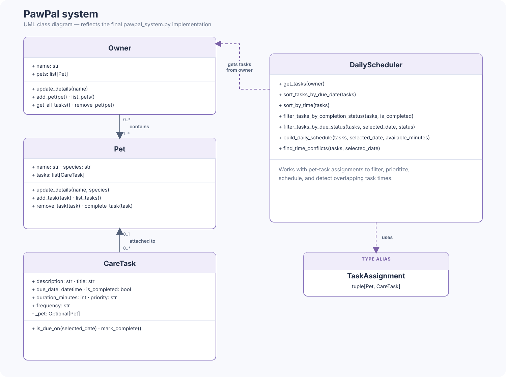

# PawPal+ (Module 2 Project)

You are building **PawPal+**, a Streamlit app that helps a pet owner plan care tasks for their pet.

## Scenario

A busy pet owner needs help staying consistent with pet care. They want an assistant that can:

- Track pet care tasks (walks, feeding, meds, enrichment, grooming, etc.)
- Consider constraints (time available, priority, owner preferences)
- Produce a daily plan and explain why it chose that plan

Your job is to design the system first (UML), then implement the logic in Python, then connect it to the Streamlit UI.

## What you will build

Your final app should:

- Let a user enter basic owner + pet info
- Let a user add/edit tasks (duration + priority at minimum)
- Generate a daily schedule/plan based on constraints and priorities
- Display the plan clearly (and ideally explain the reasoning)
- Include tests for the most important scheduling behaviors

## Getting started

### Setup

```bash
python -m venv .venv
source .venv/bin/activate  # Windows: .venv\Scripts\activate
pip install -r requirements.txt
```

### Suggested workflow

1. Read the scenario carefully and identify requirements and edge cases.
2. Draft a UML diagram (classes, attributes, methods, relationships).
3. Convert UML into Python class stubs (no logic yet).
4. Implement scheduling logic in small increments.
5. Add tests to verify key behaviors.
6. Connect your logic to the Streamlit UI in `app.py`.
7. Refine UML so it matches what you actually built.

## Implementation Summary

PawPal+ turns pet care tasks into a daily plan. An `Owner` keeps track of `Pet` objects, and each pet manages its own `CareTask` objects, which store details like due date, duration, priority, and recurrence. The `DailyScheduler` finds incomplete tasks due on the selected day, prioritizes them, and fits them into the available time. Finally, the Streamlit app collects the details and displays the plan.

## UML Class Diagram



## 🖥️ Sample Output

Paste a sample of your app's CLI or Streamlit output here so a reader can see what a generated plan looks like:

```
Today's Schedule for Jordan (2 pets):
- 08:00 Mochi: Walk (30 min, high priority, daily)
- 09:00 Luna: Feed (10 min, medium priority, daily)
- 17:30 Mochi: Play (20 min, low priority, daily)
```

## Testing PawPal+

Run the test suite from the project root:

```bash
python -m pytest
```

To run only the PawPal scheduler tests:

```
python -m pytest tests/test_pawpal.py
```

The tests cover task completion, chronological sorting, daily and weekly recurring
occurrences, and detecting conflicting task times.

Test output:

```
==================== test session starts =====================
platform darwin -- Python 3.9.6, pytest-8.4.2, pluggy-1.6.0
rootdir: /Users/kt/Desktop/codePath2026/projects/ai110-module2show-pawpal-starter
collected 6 items                                            

tests/test_pawpal.py ......                            [100%]

===================== 6 passed in 0.01s ======================
```
**Confidence Level:** ⭐⭐⭐⭐☆ (4/5) — The current tests pass for task completion,
sorting, recurring tasks, and conflict detection. This is a positive signal, but
the test suite is small and does not cover every possible case.

## Smarter Scheduling

| Feature | Method(s) | How it works |
|---------|-----------|--------------|
| Collect tasks for an owner | `Owner.get_all_tasks`, `DailyScheduler.get_tasks` | Returns each task paired with the pet it belongs to. |
| Sort tasks | `DailyScheduler.sort_tasks_by_due_date`, `DailyScheduler.sort_by_time` | Sorts by full due date/time or by time of day alone. |
| Filter tasks | `DailyScheduler.filter_tasks_by_completion_status`, `DailyScheduler.filter_tasks_by_due_status` | Filters by completion, or selects incomplete tasks that are due today, upcoming, or overdue. |
| Recurring due dates | `CareTask.is_due_on` | Determines whether one-time, daily, or weekly tasks occur on the selected date. |
| Build a daily plan | `DailyScheduler.build_daily_schedule` | Prioritizes high- to low-priority tasks, then earlier due times; skips tasks that exceed the available minutes. |
| Detect time conflicts | `DailyScheduler.find_time_conflicts` | Finds overlapping task durations on the selected date, including across pets and recurring tasks. The app and CLI demo display a warning rather than stopping. |
| Create recurring occurrences | `CareTask.mark_complete` | When an attached daily or weekly task is completed, adds its next occurrence. |
| Validate task details | `CareTask.__post_init__` | Requires positive duration, an allowed priority, and an allowed frequency. |

## Demo Walkthrough

1. Edit the owner name and add pets with their species.
2. Add tasks with a due date and time, duration, priority, and frequency. Filter or sort the task list, and mark tasks complete.
3. Choose a schedule date and available time, then select **Generate schedule**. PawPal+ prioritizes tasks, includes those that fit, and warns about overlapping tasks.
4. Run the CLI example to see sorting, completion status, conflict warnings, and a sample schedule.

Run the CLI example with:

```bash
python main.py
```

Sample output from a run on October 21, 2026:

```
Tasks in insertion order:
- 2026-10-22 07:00 Mochi: Feed (incomplete)
- 2026-10-21 08:00 Mochi: Walk (completed)
- 2026-10-22 08:00 Mochi: Walk (incomplete)
- 2026-10-21 09:00 Mochi: Walk (incomplete)
- 2026-10-21 17:30 Luna: Play (incomplete)
- 2026-10-21 09:00 Luna: Breakfast (incomplete)

Tasks sorted by date and time:
- 2026-10-21 08:00 Mochi: Walk
- 2026-10-21 09:00 Mochi: Walk
- 2026-10-21 09:00 Luna: Breakfast
- 2026-10-21 17:30 Luna: Play
- 2026-10-22 07:00 Mochi: Feed
- 2026-10-22 08:00 Mochi: Walk

Tasks sorted by time of day (date ignored):
- 2026-10-22 07:00 Mochi: Feed
- 2026-10-21 08:00 Mochi: Walk
- 2026-10-22 08:00 Mochi: Walk
- 2026-10-21 09:00 Mochi: Walk
- 2026-10-21 09:00 Luna: Breakfast
- 2026-10-21 17:30 Luna: Play

Completed tasks:
- Mochi: Walk

Incomplete tasks:
- Mochi: Feed
- Mochi: Walk
- Mochi: Walk
- Luna: Play
- Luna: Breakfast
WARNING: Time conflict: Mochi's Walk overlaps Luna's Breakfast.

Today's Schedule for Jordan (2 pets):
- 09:00 Mochi: Walk (30 min, high priority, once)
- 09:00 Luna: Breakfast (10 min, medium priority, daily)
- 17:30 Luna: Play (20 min, low priority, daily)
```
